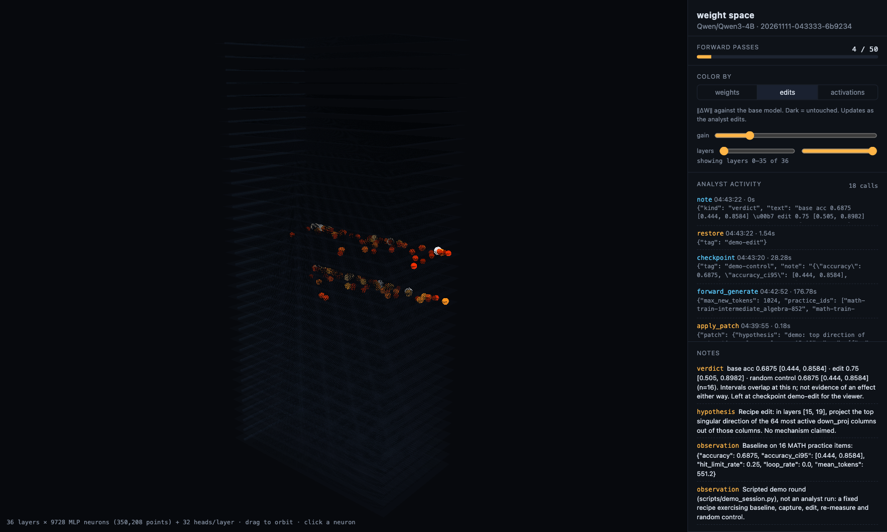
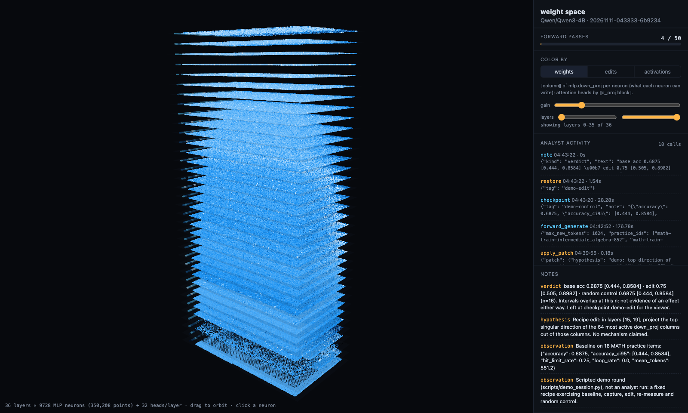
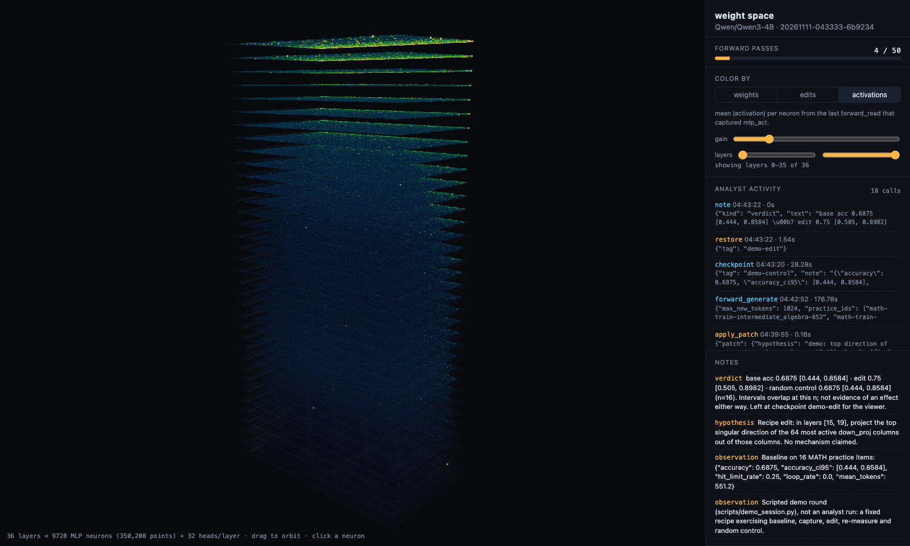
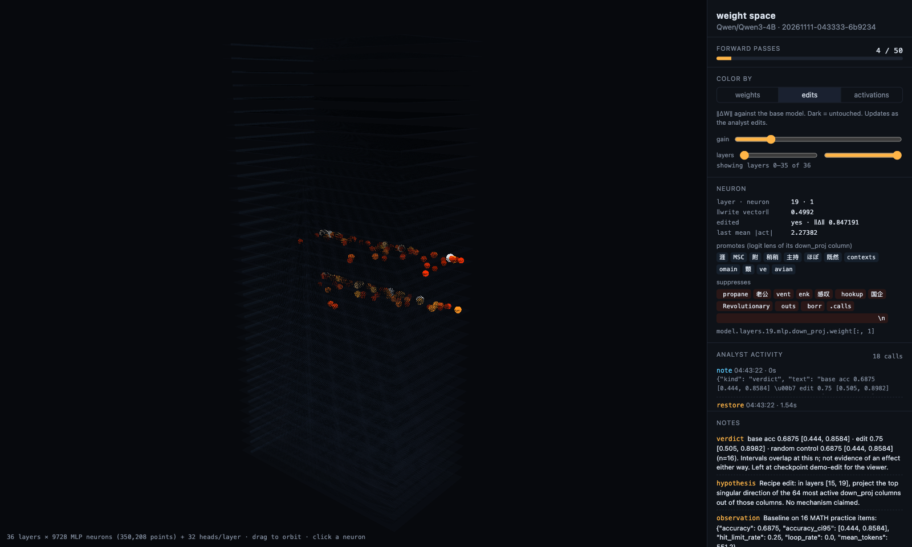

# wsp-harness: weight-space programming on Qwen3-4B

**[Project page and 3D replay](https://shivanshtalwar0.github.io/wsp-harness/)** · built on
[Sparks of Weight-Space Programming](https://rikiyat.github.io/blog/weight-space-programming/)
(Takehi, Teoh, Zhang, Khattab, MIT CSAIL, Nov 2026)



A live lab where a frontier model (Claude Opus or Fable) improves **Qwen/Qwen3-4B** by editing its
weights directly. There is no training and there are no gradients. The analyst gets the paper's
setup over MCP: a Python sandbox over the live weights, a metered budget of forward passes,
structured edits with checkpoints and controls. A held-out test set stays with you. Every edit is
validated automatically against the base model, and a 3D viewer shows neurons, edits,
validation and the analyst's calls as they happen.

---

## The model

| | Qwen3-4B |
|---|---|
| parameters | 4.02 B (bf16: 8 GB) |
| layers | 36 decoder blocks |
| hidden / MLP width | 2,560 / 9,728 (SiLU-gated) |
| attention | 32 query heads, 8 KV heads (GQA), head dim 128 |
| vocabulary | 151,936, input and output embeddings **tied** |
| chat | Qwen chat template; thinking mode off by default (`--thinking` to enable) |

In the viewer, each MLP neuron is one column of `mlp.down_proj` (`[2560, 9728]`): 350,208
points in all, plus 1,152 attention heads.

**Where it has room to improve** (measured here, non-thinking, greedy, 1,024-token cap):

| practice set | accuracy | answers cut off at the cap |
|---|---|---|
| GSM8K train, 8 items | 8/8 | 0%: saturated, nothing to fix |
| MATH train, 16 items | 11/16 (69%) | 25% |
| MATH train, 64 items (Opus baseline) | 70.3% [58–80] | 21.9% |

So the defaults are the paper's pairing: practice on MATH train, validate on MATH test minus
MATH-500, and score on MATH-500. The truncated answers are the kind of obstacle the paper says
an edit can remove. Ordinary reasoning errors are not.

---

## Quickstart

```bash
git clone https://github.com/shivanshtalwar0/wsp-harness && cd wsp-harness
python -m venv .venv && . .venv/bin/activate
pip install -e ".[lab,dev]"

# 1. the lab + 3D viewer (downloads Qwen3-4B, about 8 GB, on first run)
python -m wsp.lab serve --model Qwen/Qwen3-4B --budget 50
#    viewer: http://127.0.0.1:8765/

# 2. held-out baseline on MATH-500 (operator only)
python -m wsp.lab eval --n 200

# 3. the analyst: Claude Opus by default, or Fable
scripts/run_analyst.sh
scripts/run_analyst.sh "Reduce truncated answers on practice math" claude-fable-5-2

# 4. did it help? then export the edit
python -m wsp.lab eval --n 500 --checkpoint final
python -m wsp.lab eval --n 500 --checkpoint base
python -m wsp.lab validation                       # per-edit history
python -m wsp.lab export --full-model
```

No GPU or download handy? `--model tiny-qwen3 --device cpu --dtype float32 --practice toy --eval
toy --val toy` runs a 4-layer random Qwen3 offline.

---

## Three splits, and per-edit validation

| split | default | who sees it | used for |
|---|---|---|---|
| practice | MATH train (7,498) | analyst | probing, baselines, its own keep/revert decisions |
| validation | MATH test minus MATH-500 (4,500) | operator (analyst only with `--val-visible`) | automatic check after **every** weight change |
| test | MATH-500 | operator only | the final score |

Each time the weights change (a sandbox write, `apply_patch`, `restore`), the lab re-scores a fixed
set of validation items in the background. It doesn't touch the analyst's budget.

- **Answer loss, always on, takes seconds.** This is the mean per-token loss of each reference
  solution given its problem, compared item by item with the base model on the same items. The
  verdict is **better**, **worse** or **inconclusive**, from the 95% interval of the paired
  difference. Pairing is what makes small effects visible. On the tiny model, doubling 30 MLP
  columns read as "worse" with Δ +0.0006 [+0.0004, +0.0007]: 100 of 128 items got worse.
- **Generation accuracy, optional (`--val-gen-n 64`), slower.** Greedy answers on the first N
  items, graded and reported as paired wins and losses with an exact sign test.

The viewer charts one bar per weight state (down means lower loss). `python -m wsp.lab
validation` prints the full history.

**Why the validation split is kept away from the analyst by default:** if its edits are steered
by a number, that number stops measuring generalization. The validation split guards against
fooling yourself mid-run, and MATH-500 stays untouched for the final answer.

---

## Speed: Apple Silicon and CUDA

| option | default | what it does |
|---|---|---|
| length-sorted batching | always | groups prompts of similar length, so less padding is wasted |
| `--batch-size` | auto: 64 on CUDA, 16 otherwise | sequences per batch |
| `--attn` | `auto` | FlashAttention-2 on CUDA when `flash-attn` is installed, else PyTorch SDPA |
| TF32 matmuls | on, on CUDA | float32 analysis and logits run on tensor cores |
| `--compile` | off | static KV cache + `torch.compile` for decoding (CUDA). In-place edits keep tensor addresses, so compiled graphs stay valid. |
| `--gen-backend vllm` | `hf` | vLLM generation, typically an order of magnitude faster. The HF model stays the source of truth; before each generation, the lab pushes only the tensors that changed since the last sync, including tensors restored to base. Steering falls back to HF. **Experimental: the sync logic is unit-tested, but vLLM itself has not yet been run on CUDA.** |
| `--base-device cpu` | same device as the model | keeps the pristine base copy off the GPU (useful with vLLM's second model copy) |

GPU memory, roughly: the HF backend needs 2× the model (live + base) plus activations, about
20 GB for Qwen3-4B, or about 12 GB with `--base-device cpu`. vLLM adds another 8 GB plus its KV
cache. Measured on an Apple M5 Pro (MPS, bf16): a capture pass over all 36 layers takes about 4 s.
A 16-problem generation pass at 1,024 tokens takes about 90–180 s, since generation dominates
every pass.

---

## The 3D viewer

`http://127.0.0.1:8765/`, served by the lab:

- **weights**: ‖down_proj column‖, how much each neuron can write;
- **edits**: ‖ΔW‖ against the base model; appears ~0.3 s after an edit lands;
- **activations**: mean |activation| from the last capture pass;
- **validation**: the per-edit better/worse chart;
- click a neuron for its write norm, edit state, last activation, and the tokens it promotes or
  suppresses (logit lens).

Updates are pushed over server-sent events, the moment anything changes. Recoloring 350k points
is a table lookup. Edits are sent sparse (changed neurons only). Nothing in the viewer waits on
the model; during a long pass, the header shows what's running.

| weights | activations | neuron inspector |
|---|---|---|
|  |  |  |

---

## What the analyst gets

Twelve MCP tools and nothing else: `run_analyst.sh` runs Claude with `--tools ""`, so it has no
shell, file or web access. The tools: `lab_info`, `python` (sandbox: `W`, `acts`, `logit_lens`,
`top_singular`…), `practice_problems`, `forward_generate` and `forward_read` (1 pass each),
`apply_patch` (with `control="random"`), `weight_diff`, `checkpoint`, `restore`,
`list_checkpoints`, `note`, `budget`, and `validation` (hidden unless shared). System prompt:
[`prompts/analyst.md`](prompts/analyst.md). Full reference: [`docs/05-lab.md`](docs/05-lab.md).

---

## Results so far

- **Scripted demo round** (`scripts/demo_session.py`, a fixed recipe, not an analyst): baseline
  11/16, edit 12/16, random control 11/16 on MATH practice. The intervals overlap: a null
  result, reported as one.
- **First Opus run** (25 passes): in progress. It found that ~22% of answers truncate at the
  token cap, and showed that a "be concise" steering direction cut truncation (21.9% → 9.4%) but
  *lowered* accuracy (70.3% → 64.1%). It is now testing a token-level edit.

## Limits, stated plainly

1. **Not distillation.** Claude's knowledge does not flow into Qwen; only the edits it reasons
   its way to do. The paper's own control found that edits remove obstacles hiding an ability
   (loops, truncation, format drift) and do not add abilities the model lacks.
2. **The sandbox is a convenience boundary, not a security one.** It can read files. In the
   first Opus run the analyst read the harness's own source to learn the prompt format; it never
   touched held-out data. Audit `ledger.jsonl` and the transcript before trusting a score.
3. **bf16 resolution.** Edits under ~0.4% of a weight's magnitude round away. `apply_patch`
   reports fidelity; `--dtype float32` avoids it.
4. **Small samples lie.** Use the paired validation, and judge on MATH-500 at n ≥ 200.

---

## Layout

```
wsp/lab/            the live lab
  session.py        Lab: model, sandbox, budget, checkpoints, weight versions, ledger, viewer data
  forward.py        metered generate/read, activation capture, steering, answer-NLL scoring
  validate.py       per-edit paired validation (answer loss, optional generation, sign test)
  engines.py        optional vLLM generation backend with live weight sync (CUDA, experimental)
  edits.py          base copy, diff, checkpoints, Patch-IR ops in torch, random control
  sandbox.py        the analyst's Python namespace over live weights
  data.py           practice / validation / test splits (MATH, MATH-500, GSM8K, jsonl) and grading
  model.py          loading, device and attention selection, tiny offline model
  server.py         HTTP: /api (analyst), /admin (operator), /viz + SSE stream + viewer
  mcp_server.py     MCP proxy exposing analyst tools only
  viewer/           three.js weight-space view
prompts/analyst.md  system prompt for the Opus / Fable analyst
scripts/            run_analyst.sh, demo_session.py, build_site.py, show_stream.py
site/               GitHub Pages: landing page, screenshots, static replay
tests/test_lab.py   lab tests on an offline tiny Qwen3
wsp/{patch,quant,weights,verify,probes,analyst,cli}.py, evals/   earlier 4-bit 27B tooling
docs/               paper map, feasibility, method, runbook, results, lab reference
```

## Earlier work: Qwen3.8-27B in 4-bit

This repo started as weight-space programming on a 4-bit MLX Qwen3.8-27B coding agent. That
work includes quant-aware patching verified bit-exact against MLX, a weight atlas, failure
probes and an agent eval harness. Its first base-vs-edit run was a clean null result. It lives
in [`docs/06-qwen38-27b-4bit.md`](docs/06-qwen38-27b-4bit.md), and the method it established
([`docs/02-method.md`](docs/02-method.md)) is the one the lab follows.
